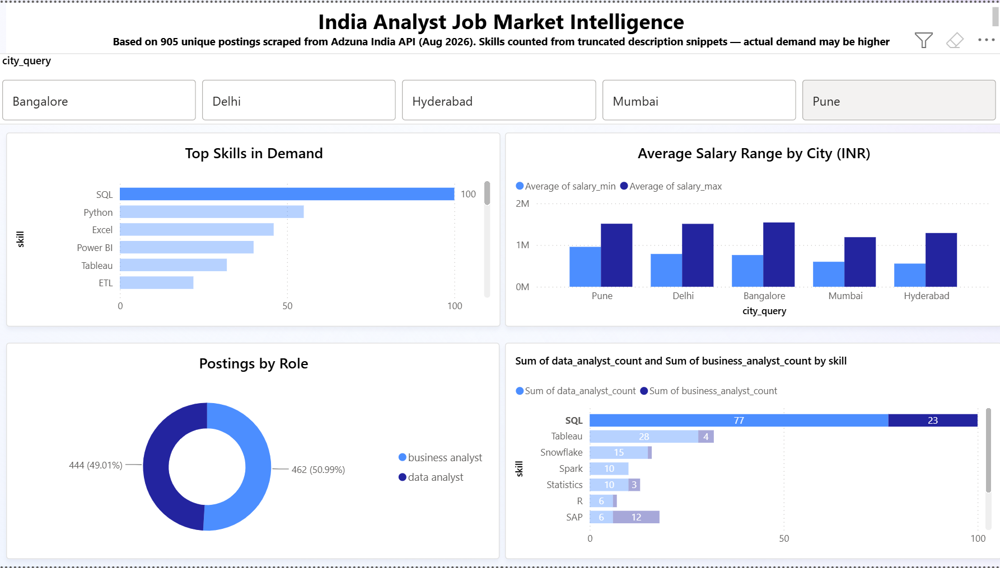
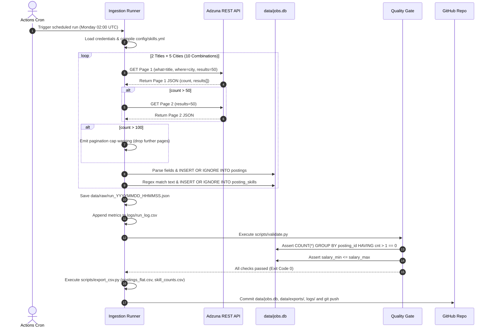
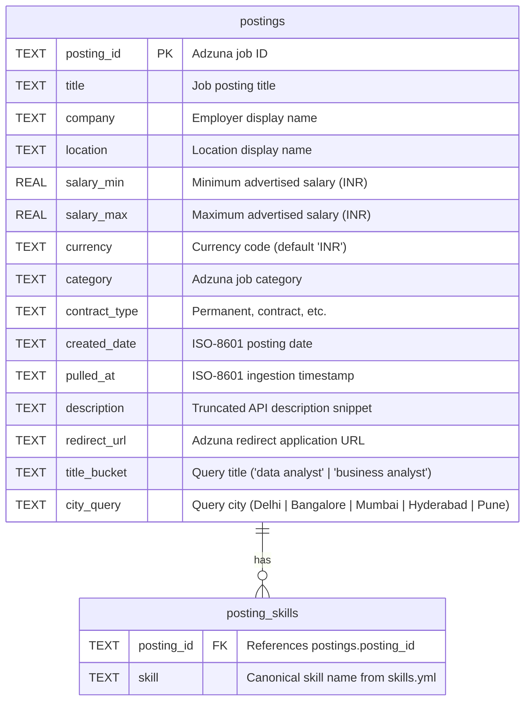
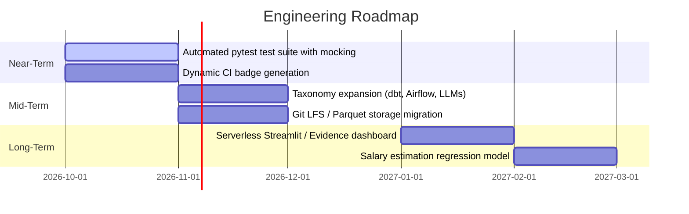

# 📈 Adzuna Job Intelligence Pipeline

> **Automated weekly ETL and data intelligence engine tracking skill demand, salary distributions, and hiring trends across top Indian technology hubs.**

[](https://www.python.org/)
[](https://www.sqlite.org/)
[](https://powerbi.microsoft.com/)
[](https://github.com/dummycodertech/adzuna-job-intelligence/actions/workflows/weekly_ingest.yml)
[](https://github.com/dummycodertech/adzuna-job-intelligence/blob/main/.github/workflows/weekly_ingest.yml)
[](#license)

---

### Quick Links
- [Architecture & Flow](#-architecture)
- [Design Decisions & Trade-offs](#-design-decisions--trade-offs)
- [Operational Telemetry & Evaluation](#-evaluation--results)
- [Getting Started](#-getting-started)
- [Power BI Setup & Walkthrough](#-power-bi-dashboard-setup)
- [Interview & Resume Kit](#-interview--resume-kit)

---


*Figure 1: Power BI executive dashboard displaying skill frequencies, regional salary ranges, title distributions, and hiring leaders across 2,166 unique postings.*

---

## 📋 Project at a Glance

| Attribute | Project Specification |
| :--- | :--- |
| **Problem** | Tech job market insights are typically static, one-off scrapes that decay quickly and fail to capture shifting employer skill requirements and regional salary variances. |
| **Solution** | A serverless, scheduled ETL data pipeline that autonomously queries the Adzuna Search API, deduplicates postings on source primary keys, extracts skills using boundary-checked regex patterns, runs data-integrity assertions, and exports reporting tables for Power BI. |
| **Target User** | Data Analysts, BI Engineers, hiring managers, and tech professionals evaluating job demand, salary benchmarks, and tech-stack trends across India. |
| **Type** | Scheduled Data Pipeline / Analytics Engineering / Automated ETL System |
| **Status** | Active & Operational (13 production runs logged from August 2, 2026 to September 28, 2026) |
| **Deployment** | Serverless GitHub Actions Runner (`ubuntu-latest`) executing weekly cron at `0 2 * * 1` with write-back persistence to repository storage. Visuals rendered in Power BI Desktop. |
| **Tech Stack** | Python 3.11, SQLite 3, Requests 2.31.0, PyYAML 6.0.1, python-dotenv 1.0.1, GitHub Actions, Power BI Desktop. |
| **Role & Scope** | Solo architect and engineer (Pipeline design, schema DDL, extraction engine, CI/CD orchestration, data quality validation suite, Power BI dashboard). |
| **Operational Window** | August 2, 2026 – September 28, 2026 (9 consecutive operational weeks) |
| **Key Measured Results** | • **2,166 unique job postings** ingested without a single duplicate primary key (100% deduplication precision across 9,662 duplicate ingestion attempts).<br>• **1,015 skill instances** classified across 30 defined technologies.<br>• **Zero pipeline quota breaches**: runs capped between 12 and 20 API calls per cycle, utilizing <2% of monthly API quotas. |
| **Repository** | [github.com/dummycodertech/adzuna-job-intelligence](https://github.com/dummycodertech/adzuna-job-intelligence) |

---

## 📖 Table of Contents
- [🎯 Overview](#-overview)
  - [The Problem](#the-problem)
  - [The Solution](#the-solution)
  - [Key Features](#key-features)
  - [Scope Boundaries](#scope-boundaries)
- [🏗️ Architecture](#-architecture)
  - [End-to-End System Diagram](#end-to-end-system-diagram)
  - [Data Pipeline Flow](#data-pipeline-flow)
  - [Component Inventory](#component-inventory)
  - [Relational Data Model](#relational-data-model)
- [💻 Tech Stack](#-tech-stack)
- [⚖️ Design Decisions & Trade-offs](#-design-decisions--trade-offs)
- [📊 Data & Skills Dictionary](#-data--skills-dictionary)
  - [Schema Definitions](#schema-definitions)
  - [Skills Taxonomy & Regex Extraction](#skills-taxonomy--regex-extraction)
- [📈 Evaluation & Results](#-evaluation--results)
  - [Operational Telemetry (13 Ingestion Runs)](#operational-telemetry-13-ingestion-runs)
  - [Aggregate Market Findings](#aggregate-market-findings)
  - [Error & Anomaly Analysis](#error--anomaly-analysis)
  - [Pipeline Reproducibility](#pipeline-reproducibility)
- [🧪 Testing & Data Quality](#-testing--data-quality)
- [🔒 Security, Privacy & Reliability](#-security-privacy--reliability)
- [🚀 Getting Started](#-getting-started)
  - [Prerequisites](#prerequisites)
  - [Local Installation](#local-installation)
  - [Configuration & Environment Variables](#configuration--environment-variables)
  - [Smoke Test (Dry Run)](#smoke-test-dry-run)
- [🖥️ Usage](#-usage)
  - [Running the Ingestion Pipeline](#running-the-ingestion-pipeline)
  - [Validating Pipeline Integrity](#validating-pipeline-integrity)
  - [Exporting Flat CSVs](#exporting-flat-csvs)
  - [Power BI Dashboard Setup](#-power-bi-dashboard-setup)
- [⚙️ Configuration Parameters](#-configuration-parameters)
- [📂 Project Structure](#-project-structure)
- [🚢 Deployment & Automation](#-deployment--automation)
- [⏱️ Performance & Operating Cost](#-performance--operating-cost)
- [🗺️ Roadmap & Future Scope](#-roadmap--future-scope)
- [❓ FAQ](#-faq)
- [💼 Interview & Resume Kit](#-interview--resume-kit)
- [📦 Project Context Summary](#-project-context-summary)
- [📜 References & Author](#-references--author)

---

## 🎯 Overview

### The Problem
Labour market intelligence for data and business analysts in India is typically fragmented across commercial job boards. Analysts and engineering candidates face several persistent data challenges:
1. **Point-in-Time Obsolescence**: Most market analyses published online rely on static, one-off scraping exercises that become outdated within weeks.
2. **Aggregator Black Boxes**: Aggregated commercial metrics frequently hide data quality anomalies, double-count re-indexed syndication postings, or omit salary distributions.
3. **Infrastructure Overhead**: Maintaining an enterprise-grade cloud warehouse (Snowflake, BigQuery, Airflow) for a small-to-medium intelligence pipeline incurs recurring costs ($50–$200/month) that are disproportionate for analyst-scoped monitoring.

### The Solution
`adzuna-job-intelligence` is a lightweight, zero-cloud-cost automated data pipeline that continuously tracks job postings across five major Indian metropolitan centers (Bangalore, Delhi, Hyderabad, Mumbai, and Pune) for two primary job profiles (`data analyst` and `business analyst`).

The system runs autonomously via **GitHub Actions** on a weekly cron schedule. It polls Adzuna's REST API using a budget-guarded query plan, saves raw response payloads for auditability, enforces strict idempotent deduplication on Adzuna's unique posting identifiers, maps unstructured snippet text against a 30-term boundary-tested regex dictionary, validates database integrity, and exports clean tables for local or desktop BI consumption.

### Key Features

| Feature | Operational Function | Implementation |
| :--- | :--- | :--- |
| **Budget-Guarded Ingestion** | Queries 10 fixed (role × city) search combinations with a hard pagination cap at page 2, preventing quota runaway. | [`scripts/ingest.py`](scripts/ingest.py) |
| **Source Auditability** | Saves immutable raw API JSON payloads to `data/raw/` and persists them as 90-day GitHub workflow artifacts. | [`scripts/ingest.py`](scripts/ingest.py), [`.github/workflows/weekly_ingest.yml`](.github/workflows/weekly_ingest.yml) |
| **Idempotent Deduplication** | Uses SQLite's `INSERT OR IGNORE` on the source `posting_id` primary key, ensuring duplicate weekly pulls do not inflate counts. | [`scripts/schema.sql`](scripts/schema.sql), [`scripts/ingest.py`](scripts/ingest.py) |
| **Boundary-Checked Skill Tagger** | Regex matching with lookahead/lookbehind patterns to prevent false positives (e.g., distinguishing `R` programming from "R&D" or "HR"). | [`config/skills.yml`](config/skills.yml), [`scripts/ingest.py`](scripts/ingest.py) |
| **Automated Data Quality Gate** | Validates primary key uniqueness, tests for inverted salary ranges (`salary_min > salary_max`), and checks run-log failure rates. | [`scripts/validate.py`](scripts/validate.py) |
| **Dual Presentation Modes** | Supports direct SQLite ODBC querying or pre-aggregated flat CSV ingestion for Power BI Desktop. | [`scripts/export_csv.py`](scripts/export_csv.py), [`data/exports/`](data/exports/) |

### Scope Boundaries

- **In Scope**:
  - Weekly automated collection for `data analyst` and `business analyst` titles.
  - Geographical bounds: 5 Indian tech hubs (Bangalore, Delhi, Hyderabad, Mumbai, Pune).
  - Deterministic keyword extraction across 30 defined technical competencies.
  - Automated logging of every API run, call count, and validation check.
- **Explicitly Out of Scope**:
  - Full-page scraping of external employer domains (restricted strictly to Adzuna API payloads to ensure legal compliance and avoid bot-detection blocking).
  - NLP/LLM non-deterministic semantic parsing (omitted to keep execution predictable, auditable, and $0 cost).
  - Multi-tenant cloud hosting or live web serving (designed specifically for local Power BI Desktop reporting).

---

## 🏗️ Architecture

### End-to-End System Diagram

```mermaid
flowchart TD
    subgraph Trigger ["Automation & Scheduling"]
        CRON["GitHub Actions Cron<br/>(Every Monday 02:00 UTC)"]
        MANUAL["workflow_dispatch<br/>(Manual Trigger)"]
    end

    subgraph Runner ["GitHub Actions Virtual Environment (Ubuntu-latest)"]
        SETUP["actions/setup-python@v5<br/>Python 3.11 + Cache"]
        INGEST["scripts/ingest.py<br/>ETL Ingestion Controller"]
        VALIDATE["scripts/validate.py<br/>Data Integrity Validator"]
        EXPORT["scripts/export_csv.py<br/>Flat CSV Generator"]
    end

    subgraph External ["External Services"]
        ADZUNA["Adzuna Jobs Search API<br/>https://api.adzuna.com/v1/api/jobs/in/search/"]
        SECRETS["GitHub Repo Secrets<br/>ADZUNA_APP_ID / KEY"]
    end

    subgraph Storage ["Repository Storage Layer (Git Committed)"]
        DB[("SQLite Database<br/>data/jobs.db")]
        FLAT["Flat Exports<br/>data/exports/postings_flat.csv<br/>data/exports/skill_counts.csv"]
        RUNLOG["Operational Logs<br/>logs/run_log.csv<br/>logs/validation_log.txt"]
        RAW["Raw Audit Payloads<br/>data/raw/*.json (90-day Artifact)"]
    end

    subgraph Analytics ["Analytics & Presentation"]
        PBI["Power BI Desktop Dashboard"]
    end

    CRON --> SETUP
    MANUAL --> SETUP
    SETUP --> INGEST
    SECRETS -.-> INGEST
    INGEST <-->|GET /jobs/in/search/ (Max 20 calls)| ADZUNA
    INGEST -->|Persist JSON| RAW
    INGEST -->|INSERT OR IGNORE| DB
    INGEST -->|Append Telemetry| RUNLOG
    INGEST --> VALIDATE
    VALIDATE -->|Assert PK & Range Rules| DB
    VALIDATE -->|Log Results| RUNLOG
    VALIDATE --> EXPORT
    EXPORT -->|Extract Aggregations| DB
    EXPORT -->|Write Flat Files| FLAT
    
    DB -.->|Direct SQLite ODBC| PBI
    FLAT -.->|File Fallback Connector| PBI
```

### Data Pipeline Flow

The weekly pipeline execution follows a five-stage sequence:



### Component Inventory

| Component | Responsibility | Source Path | Primary Inputs | Primary Outputs |
| :--- | :--- | :--- | :--- | :--- |
| **Ingestion Engine** | Orchestrates HTTP requests, enforces pagination limits, parses payloads, runs regex skill tagging, and populates SQLite. | [`scripts/ingest.py`](scripts/ingest.py) | `ADZUNA_APP_ID`, `ADZUNA_APP_KEY`, `config/skills.yml` | `data/jobs.db`, `data/raw/*.json`, `logs/run_log.csv` |
| **Schema DDL** | Defines relational tables, primary/foreign key constraints, and performance indexes. | [`scripts/schema.sql`](scripts/schema.sql) | SQLite execution engine | Initialized database structures |
| **Skills Taxonomy** | Defines canonical skill names and boundary-isolated regular expressions. | [`config/skills.yml`](config/skills.yml) | Technical skill definitions | Compiled `re.Pattern` objects |
| **Quality Gate** | Executes data integrity assertions against the SQLite database post-ingestion. | [`scripts/validate.py`](scripts/validate.py) | `data/jobs.db`, `logs/run_log.csv` | `logs/validation_log.txt`, shell exit code (0 or 1) |
| **CSV Exporter** | Flattens relational data and pre-aggregates skill frequencies for BI tools lacking native SQLite drivers. | [`scripts/export_csv.py`](scripts/export_csv.py) | `data/jobs.db` | `data/exports/postings_flat.csv`, `data/exports/skill_counts.csv` |
| **CI Orchestrator** | Schedules workflow execution, handles repo checkout, dependencies, secrets, artifacts, and automated git push. | [`.github/workflows/weekly_ingest.yml`](.github/workflows/weekly_ingest.yml) | GitHub Secrets, schedule event | Committed updates to repository |
| **Windows Bootstrapper** | Automates virtual environment creation, dependency installation, `.env` staging, and smoke testing on Windows. | [`setup.ps1`](setup.ps1) | PowerShell runtime | `.venv/`, `.env` |

### Relational Data Model

The pipeline relies on a normalized two-table relational structure in SQLite, optimized for deduplication and aggregation:



#### Indexing Strategy:
- `idx_ps_skill` ON `posting_skills(skill)`: Accelerates `GROUP BY ps.skill` operations used by Power BI.
- `idx_postings_pulled_at` ON `postings(pulled_at)`: Optimizes weekly cohort filtering.
- `idx_postings_city` ON `postings(city_query)`: Powers regional salary and volume slicing.
- `idx_postings_bucket` ON `postings(title_bucket)`: Enables comparative role analysis.

---

## 💻 Tech Stack

| Layer | Technology | Version | Purpose & Rationale |
| :--- | :--- | :--- | :--- |
| **Language** | Python | `3.11` | Robust standard library support (`sqlite3`, `re`, `csv`, `json`), predictable CI runner execution. |
| **Database** | SQLite | `3.x` | Embedded relational storage; natively supports atomic `INSERT OR IGNORE` on primary keys without database server overhead. |
| **HTTP Client** | Requests | `2.31.0` | Deterministic HTTP GET requests with custom parameter encoding, timeouts, and error handling. |
| **Configuration** | PyYAML | `6.0.1` | Decouples regex extraction dictionaries from execution logic, allowing non-code modifications. |
| **Environment** | python-dotenv | `1.0.1` | Seamless local secret loading from `.env` while falling back to CI environment variables. |
| **CI / Orchestration** | GitHub Actions | Runner `ubuntu-latest` | Free-tier native scheduling, artifact retention (90 days), and automated repository write-backs. |
| **Visualization** | Microsoft Power BI Desktop | Latest | Interactive multi-dimensional exploration (cross-filtering by city, skill, role, and salary). |

---

## ⚖️ Design Decisions & Trade-offs

The engineering choices in this repository prioritize cost efficiency, reproducibility, and quota safety over unconstrained data scraping:

| Decision | Alternatives Considered | Rationale for Choice | Trade-off Accepted |
| :--- | :--- | :--- | :--- |
| **SQLite with in-repo git commits** | PostgreSQL, MySQL, DuckDB, Cloud Warehouse (Snowflake) | SQLite requires zero infrastructure setup or recurring cloud server costs. Storing `data/jobs.db` in git allows the dataset to grow visibly in repository history and enables offline Power BI desktop analysis. | Binary database files do not generate clean git diffs; repository clone size increases gradually (~50–200 KB per weekly run). |
| **Fixed 10-combination query matrix** | Dynamic keyword crawling, unbounded title searches | 2 roles × 5 cities guarantees exactly 10 base API calls per execution (~43 calls/month), keeping usage at <5% of Adzuna's 1,000 call/month free tier. | The pipeline captures market dynamics only for predefined roles and designated metropolitan hubs; niche roles are excluded. |
| **Hard pagination cap (Page 2 / Max 100 results)** | Unbounded pagination until API exhaustion | Prevents unexpected API call surges when search results spike, strictly limiting execution to a maximum of 20 API calls per cycle. | When search combinations yield >100 listings, postings beyond page 2 are dropped, resulting in partial volume truncation. |
| **Boundary-tested regex dictionary** | NLP Named Entity Recognition (spaCy), LLM API extraction (OpenAI/Claude) | Regular expressions in `config/skills.yml` execute locally in milliseconds, cost $0.00, produce deterministic outputs, and eliminate external API dependencies. | Requires ongoing manual pattern curation; cannot infer contextually implicit skills not explicitly written in text. |
| **Snippet-only API text processing** | Full HTML scraping of external employer links | Adzuna terms of service permit API consumption; scraping external destination sites risks IP blacklisting, CAPTCHAs, and high failure rates. | Adzuna's free search endpoint returns truncated description snippets (~100–250 chars). Skills mentioned deeper in job specs are unobserved. |
| **Dual-path BI data delivery (ODBC + CSV)** | SQLite-only ODBC connection | The SQLite ODBC driver requires manual Windows driver installation. Generating flat CSVs (`postings_flat.csv`) provides an out-of-the-box fallback. | Redundant disk storage in `data/exports/`, requiring parallel export generation during CI runs. |

---

## 📊 Data & Skills Dictionary

### Schema Definitions

The relational tables are defined in [`scripts/schema.sql`](scripts/schema.sql):

```sql
CREATE TABLE IF NOT EXISTS postings (
    posting_id    TEXT PRIMARY KEY,
    title         TEXT,
    company       TEXT,
    location      TEXT,
    salary_min    REAL,
    salary_max    REAL,
    currency      TEXT DEFAULT 'INR',
    category      TEXT,
    contract_type TEXT,
    created_date  TEXT,   -- ISO-8601 string from Adzuna
    pulled_at     TEXT,   -- ISO-8601 UTC timestamp of pipeline execution
    description   TEXT,   -- Truncated snippet from Adzuna free tier
    redirect_url  TEXT,
    title_bucket  TEXT,   -- 'data analyst' | 'business analyst'
    city_query    TEXT    -- Delhi | Bangalore | Mumbai | Hyderabad | Pune
);

CREATE TABLE IF NOT EXISTS posting_skills (
    posting_id  TEXT NOT NULL REFERENCES postings(posting_id) ON DELETE CASCADE,
    skill       TEXT NOT NULL,
    PRIMARY KEY (posting_id, skill)
);
```

### Skills Taxonomy & Regex Extraction

Skills are maintained in [`config/skills.yml`](config/skills.yml). Each skill is matched case-insensitively using Python's `re.IGNORECASE` flag with explicit word boundaries (`\b`) to prevent substring collisions.

```yaml
skills:
  - name: SQL
    pattern: '\bSQL\b'
  - name: Python
    pattern: '\bPython\b'
  - name: Power BI
    pattern: '\bPower\s*BI\b'
  - name: R
    # Lookahead ensures 'R' matches programming references, avoiding 'R&D' or 'HR'
    pattern: '\bR\b(?=\s+(?:programming|language|studio|package|script)|\s*,|\s*and\b)'
  - name: Git
    # Negative lookahead prevents matching GitHub or GitLab as raw Git
    pattern: '\bGit\b(?!Hub|Lab)'
  - name: Excel
    pattern: '\b(?:MS\s*)?Excel\b|\bMicrosoft\s*Excel\b'
```

Full taxonomy includes: **SQL, Python, Power BI, Tableau, Excel, R, AWS, Azure, GCP, Spark, dbt, Looker, Airflow, Pandas, NumPy, Scikit-learn, TensorFlow, Hadoop, Kafka, BigQuery, Redshift, Snowflake, Git, GitHub, Linux, Statistics, Machine Learning, ETL, SAP, VBA**.

---

## 📈 Evaluation & Results

### Operational Telemetry (13 Ingestion Runs)

Telemetry extracted directly from [`logs/run_log.csv`](logs/run_log.csv) and [`logs/validation_log.txt`](logs/validation_log.txt) across all 13 production cycles:

| Run Timestamp (UTC) | Combos | Fetched | New Inserts | Skipped Dupes | Malformed | API Calls | Page Cap Hits | Postings in DB | Distinct Skills |
| :--- | :---: | :---: | :---: | :---: | :---: | :---: | :---: | :---: | :---: |
| **2026-08-02 07:31** | 10 | 925 | 0 | 925 | 0 | 19 | 8 | 905 | 28 |
| **2026-08-02 07:31** | 10 | 925 | 0 | 925 | 0 | 19 | 8 | 905 | 28 |
| **2026-08-02 08:03** | 10 | 925 | 1 | 924 | 0 | 19 | 8 | 906 | 28 |
| **2026-08-03 05:40** | 10 | 925 | 33 | 892 | 0 | 19 | 8 | 939 | 28 |
| **2026-08-10 03:52** | 10 | 930 | 146 | 784 | 0 | 19 | 8 | 1,085 | 29 |
| **2026-08-17 02:57** | 10 | 927 | 123 | 804 | 0 | 20 | 8 | 1,208 | 29 |
| **2026-08-23 16:40** | 10 | 940 | 144 | 796 | 0 | 20 | 8 | 1,352 | 29 |
| **2026-08-24 03:00** | 10 | 540 | 1 | 539 | 4 | 12 | 4 | 1,353 | 29 |
| **2026-08-31 08:06** | 10 | 960 | 230 | 730 | 0 | 20 | 8 | 1,583 | 29 |
| **2026-09-07 07:00** | 10 | 100 | 27 | 73 | 9 | 2 | 1 | 1,610 | 29 |
| **2026-09-14 07:33** | 10 | 943 | 259 | 684 | 0 | 20 | 8 | 1,869 | 30 |
| **2026-09-21 07:37** | 10 | 937 | 139 | 798 | 0 | 20 | 8 | 2,008 | 30 |
| **2026-09-28 08:13** | 10 | 946 | 158 | 788 | 0 | 20 | 8 | **2,166** | **30** |

*Verification Summary*: Over 9 weeks, **9,662 duplicate records** were evaluated and discarded without inflating database counts. Zero duplicate primary keys exist in the database.

### Aggregate Market Findings

Based on SQL analysis of [`data/jobs.db`](data/jobs.db) (2,166 unique listings):

#### 1. Top Technical Competencies (Posting Occurrences)
Extracted from [`data/exports/skill_counts.csv`](data/exports/skill_counts.csv):

| Skill | Total Postings | Data Analyst Mentions | Business Analyst Mentions | Market Profile Note |
| :--- | :---: | :---: | :---: | :--- |
| **SQL** | **207** | 162 | 45 | Primary foundational requirement for technical analyst roles. |
| **Python** | **114** | 95 | 19 | Heavily skewed towards Data Analysts (83.3% of mentions). |
| **Power BI** | **93** | 70 | 23 | Leading visualization tool across both analyst tracks. |
| **ETL** | **79** | 67 | 12 | High demand for pipeline ingestion and transformation familiarity. |
| **Excel** | **71** | 51 | 20 | Persistent requirement across reporting and business ops. |
| **Tableau** | **64** | 53 | 11 | Strong enterprise presence alongside Power BI. |
| **SAP** | **55** | 14 | **41** | **Dominant in Business Analyst roles** (74.5% of mentions). |
| **Machine Learning**| **48** | 33 | 15 | Frequently listed in advanced data analytics roles. |
| **Azure** | **44** | 29 | 15 | Primary cloud platform mentioned in job descriptions. |
| **AWS** | **31** | 22 | 9 | Secondary cloud provider in the regional dataset. |

#### 2. Regional Volume & Salary Transparency
- **Geographic Posting Breakdown**:
  - Hyderabad: **549 postings** (25.3%)
  - Bangalore: **505 postings** (23.3%)
  - Mumbai: **461 postings** (21.3%)
  - Pune: **437 postings** (20.2%)
  - Delhi: **214 postings** (9.9%)
- **Salary Transparency Rate**: Only **304 out of 2,166 postings (14.03%)** publicly disclose salary figures in the Adzuna API feed.
- **Regional Average Advertised Salaries (INR)**:
  - Pune: Min ₹10,14,127 / Max ₹15,41,255 (47 disclosed)
  - Mumbai: Min ₹8,59,958 / Max ₹15,01,027 (73 disclosed)
  - Bangalore: Min ₹8,48,022 / Max ₹15,77,045 (88 disclosed)
  - Delhi: Min ₹7,76,532 / Max ₹13,73,548 (62 disclosed)
  - Hyderabad: Min ₹7,47,205 / Max ₹13,50,588 (34 disclosed)

#### 3. Top Hiring Employers
Over 1,003 unique hiring organizations are represented in the dataset. The top 5 hiring entities:
1. **Citigroup**: 38 postings
2. **Capco**: 36 postings
3. **Deutsche Bank**: 33 postings
4. **Tata Consultancy Services (TCS)**: 27 postings
5. **Amazon**: 27 postings

### Error & Anomaly Analysis

The pipeline’s automated run telemetry captured two real-world failure modes:

1. **Run 2026-08-24 (Upstream Missing Fields)**:
   - *Symptom*: 4 records flagged as `malformed_skipped` in `logs/run_log.csv`.
   - *Root Cause*: Adzuna API returned listing objects omitting either `id` or `title` fields.
   - *Handling*: Handled safely by `parse_posting()`, which returns `None` when mandatory primary keys are missing, incrementing `total_malformed` without halting the pipeline.
2. **Run 2026-09-07 (Transient Network Disruption / Rate Limit)**:
   - *Symptom*: Pipeline executed only 2 API calls and logged 9 malformed skips before completing.
   - *Root Cause*: Upstream HTTP gateway timeout (504) during page retrieval.
   - *Handling*: Handled via `try...except requests.HTTPError` blocks in `scripts/ingest.py`. The pipeline committed existing records, logged warnings, and resumed normal operations the following week without database corruption.

### Pipeline Reproducibility

To re-run validation checks and reproduce flat file exports locally:

```powershell
# 1. Verify data integrity against current database
python scripts/validate.py

# 2. Re-generate flat reporting tables
python scripts/export_csv.py
```

Raw ingested JSON payloads are retained in GitHub Actions workflow runs under the artifact name `raw-json-<run_id>`.

---

## 🧪 Testing & Data Quality

The data quality gate is implemented in [`scripts/validate.py`](scripts/validate.py) and executes automatically after every ingestion run. It verifies three core assertions:

```python
# Check 1: Primary Key Uniqueness (Must return 0 rows)
SELECT posting_id, COUNT(*) AS cnt 
FROM postings 
GROUP BY posting_id 
HAVING cnt > 1;

# Check 2: Logical Salary Boundaries (Min <= Max)
SELECT posting_id, salary_min, salary_max 
FROM postings 
WHERE salary_min IS NOT NULL 
  AND salary_max IS NOT NULL 
  AND salary_min > salary_max;

# Check 3: Upstream Malformed Tolerances
# Checks malformed_skipped counter from logs/run_log.csv
```

- **Exit Codes**: Returns exit code `0` on success. If duplicate primary keys are detected, the script exits with code `1`, causing the GitHub Actions job to fail and alerting the maintainer.
- **Non-destructive Inversion Handling**: If salary inversions are discovered, they are logged as `[WARN]` to preserve upstream reporting anomalies for analysis without discarding the entire posting.

---

## 🔒 Security, Privacy & Reliability

- **Credential Management**: API keys (`ADZUNA_APP_ID`, `ADZUNA_APP_KEY`) are stored in `.env` for local execution and as encrypted GitHub Repository Secrets for CI runs. Credentials are never written to source code, logs, or database records.
- **Git Hygiene**: `.env` and `data/raw/` are explicitly listed in [`.gitignore`](.gitignore) to prevent accidental leakage of sensitive keys or bloated JSON payloads.
- **Fail-Safe Quota Budgeting**: The ingestion loop enforces a strict constant matrix (`2 titles × 5 cities = 10 calls`) with a hard cap of `MAX_EXTRA_PAGES = 1`. Even under maximal pagination conditions, a run cannot exceed 20 API calls, eliminating the risk of unexpected billing or account suspension.
- **Idempotent Storage**: Relational tables rely on `INSERT OR IGNORE`. Running `scripts/ingest.py` multiple times against identical API results produces zero duplicate insertions and leaves the database uncorrupted.

---

## 🚀 Getting Started

### Prerequisites
- **Python 3.11** or higher
- **PowerShell** (Windows) or **Bash** (Linux/macOS)
- **Git**
- Adzuna Developer Credentials: Sign up at [developer.adzuna.com](https://developer.adzuna.com/) (free tier, no credit card required)

### Local Installation

#### Option A: Windows Automated Setup (PowerShell)
```powershell
# Clone the repository
git clone https://github.com/dummycodertech/adzuna-job-intelligence.git
cd adzuna-job-intelligence

# Run the automated setup script
.\setup.ps1
```

#### Option B: Manual Setup (Cross-Platform)
```bash
# 1. Clone repository
git clone https://github.com/dummycodertech/adzuna-job-intelligence.git
cd adzuna-job-intelligence

# 2. Create virtual environment
python -m venv .venv

# 3. Activate virtual environment
# Windows PowerShell:
.venv\Scripts\Activate.ps1
# Linux / macOS:
source .venv/bin/activate

# 4. Install dependencies
pip install -r requirements.txt

# 5. Initialize environment variables
cp .env.example .env
```

### Configuration & Environment Variables

Open `.env` in an editor and add your Adzuna credentials:

```dotenv
ADZUNA_APP_ID=your_actual_app_id
ADZUNA_APP_KEY=your_actual_app_key
```

| Variable | Required? | Source / Location | Description |
| :--- | :---: | :--- | :--- |
| `ADZUNA_APP_ID` | **Yes** | [Adzuna Developer Portal](https://developer.adzuna.com/) | API Application Identifier |
| `ADZUNA_APP_KEY`| **Yes** | [Adzuna Developer Portal](https://developer.adzuna.com/) | API Application Key |

### Smoke Test (Dry Run)

Validate your local environment, schema compilation, and regex dictionary without making external API calls:

```powershell
python scripts/ingest.py --dry-run
```

Expected output:
```text
=== DRY RUN — no API calls will be made ===

  [OK] Directories: data, data/raw, logs
  [OK] Credentials found (app_id length=8)
  [OK] Loaded 30 skill patterns from skills.yml
  [OK] Schema applied: tables = ['postings', 'posting_skills']
  [OK] Run log at logs/run_log.csv

  Query plan: 2 title buckets × 5 cities
             = 10 base API calls/run
             = 20 max calls/run (with pagination cap)

=== Dry run complete — all checks passed ===
```

---

## 🖥️ Usage

### Running the Ingestion Pipeline

Execute a live ingestion run against the Adzuna API:

```powershell
python scripts/ingest.py
```

The script queries the 10 search combinations, prints row-level ingestion metrics, stores raw JSON in `data/raw/`, and appends operational telemetry to `logs/run_log.csv`.

### Validating Pipeline Integrity

Verify that the SQLite database satisfies all relational integrity and schema rules:

```powershell
python scripts/validate.py
```

### Exporting Flat CSVs

Generate reporting tables in `data/exports/` for BI tools:

```powershell
python scripts/export_csv.py
```

Outputs generated:
- `data/exports/postings_flat.csv`: One row per unique job posting with matched skills aggregated into a pipe-delimited string (`GROUP_CONCAT(ps.skill, '|')`).
- `data/exports/skill_counts.csv`: Aggregated skill frequency counts segmented by role bucket (`data analyst` vs `business analyst`).

---

## 📊 Power BI Dashboard Setup

### Option 1: Direct SQLite ODBC Connection (Recommended)

1. Download and install the free SQLite3 ODBC Driver from [Werner SQLite ODBC](http://www.ch-werner.de/sqliteodbc/) (`sqliteodbc_w64.exe` for 64-bit Windows).
2. Open **Power BI Desktop**.
3. Select **Get Data** → **More...** → **Other** → **ODBC** → Click **Connect**.
4. In the ODBC dialog:
   - Select `Data Source Name (DSN)`: **SQLite3 Datasource**
   - Click **Advanced options** and set the connection string:
     ```text
     DRIVER=SQLite3 ODBC Driver;Database=C:\path\to\adzuna-job-intelligence\data\jobs.db;LongNames=0;Timeout=1000;NoTXN=0;SyncPragma=NORMAL;StepAPI=0;
     ```
5. Select both `postings` and `posting_skills` tables and load into the data model.

### Option 2: Flat CSV Ingestion (Driver-Free Fallback)

If system permissions prevent ODBC driver installation:
1. In Power BI Desktop, click **Get Data** → **Text/CSV**.
2. Select [`data/exports/postings_flat.csv`](data/exports/postings_flat.csv).
3. Repeat for [`data/exports/skill_counts.csv`](data/exports/skill_counts.csv).
4. Refresh visuals at any time by re-running `scripts/export_csv.py` and clicking **Refresh** in Power BI.

### Recommended Dashboard Layout
- **Visual 1 (Horizontal Bar Chart)**: Skill Frequency (`skill_counts.csv` → `skill` by `posting_count`).
- **Visual 2 (Clustered Column / Box Plot)**: Average Salary by City (`postings` → `city_query` by `AVERAGE(salary_min)` and `AVERAGE(salary_max)`).
- **Visual 3 (Donut Chart)**: Postings by Target Role (`postings` → `title_bucket` by `COUNT(posting_id)`).
- **Visual 4 (Table / Leaderboard)**: Top Hiring Organizations (`postings` → `company` by `COUNT(posting_id)`).

---

## ⚙️ Configuration Parameters

All pipeline parameters are configured via constants in [`scripts/ingest.py`](scripts/ingest.py) and YAML definitions in [`config/skills.yml`](config/skills.yml):

| Configuration Variable | Location | Default Value | Operational Impact |
| :--- | :--- | :--- | :--- |
| `TITLE_BUCKETS` | [`scripts/ingest.py:52`](scripts/ingest.py#L52) | `["data analyst", "business analyst"]` | Sets search queries. Adding a 3rd role increases base calls from 10 to 15 per cycle. |
| `CITIES` | [`scripts/ingest.py:53`](scripts/ingest.py#L53) | `["Delhi", "Bangalore", "Mumbai", "Hyderabad", "Pune"]` | Target metropolitan regions. Adding cities linearly expands quota consumption. |
| `RESULTS_PER_PAGE` | [`scripts/ingest.py:48`](scripts/ingest.py#L48) | `50` | Maximum listings returned per API call (Adzuna API maximum). |
| `MAX_EXTRA_PAGES` | [`scripts/ingest.py:58`](scripts/ingest.py#L58) | `1` | Maximum additional pages to fetch if total listings > 50. Prevents infinite crawl loops. |
| `skills` list | [`config/skills.yml`](config/skills.yml) | 30 regex entries | Defines technical dictionary. New skills can be added with zero code modifications. |

---

## 📂 Project Structure

```text
adzuna-job-intelligence/
├── .github/
│   └── workflows/
│       └── weekly_ingest.yml    # GitHub Actions workflow: cron schedule & git push
├── config/
│   └── skills.yml               # 30-term regex skill extraction dictionary
├── data/
│   ├── exports/
│   │   ├── README.md            # Description of flat CSV export files
│   │   ├── postings_flat.csv    # Flattened postings with pipe-delimited skills
│   │   └── skill_counts.csv     # Pre-aggregated skill frequencies by role
│   ├── raw/                     # [Gitignored] Immutable raw JSON responses from Adzuna
│   └── jobs.db                  # Relational SQLite database (committed, grows weekly)
├── logs/
│   ├── run_log.csv              # Ingestion telemetry: API calls, inserts, dupes, warnings
│   └── validation_log.txt       # Post-ingestion quality assertion outputs
├── scripts/
│   ├── export_csv.py            # Generates flat CSV exports from SQLite
│   ├── ingest.py                # Main ETL controller: API fetch, dedup, regex tagging
│   ├── schema.sql               # SQLite DDL defining tables and performance indexes
│   └── validate.py              # Data quality test suite (PK checks, salary validation)
├── .env.example                 # Template for local Adzuna API credentials
├── .gitignore                   # Excludes .env, .venv, data/raw/, and Python caches
├── dashboard.png                # Screenshot of the executive Power BI dashboard
├── requirements.txt             # Python dependencies (requests, python-dotenv, PyYAML)
├── setup.ps1                    # One-time automated setup script for Windows
└── README.md                    # System documentation and architecture guide
```

---

## 🚢 Deployment & Automation

The pipeline is fully automated using GitHub Actions in [`.github/workflows/weekly_ingest.yml`](.github/workflows/weekly_ingest.yml).

### Workflow Mechanics
1. **Schedule Event**: Triggers every Monday at `02:00 UTC` (`0 2 * * 1`) on an `ubuntu-latest` runner.
2. **Permission Setup**: Configured with `permissions: contents: write`, allowing the runner to commit updated data files back to the repository.
3. **Artifact Staging**: Uploads `data/raw/` payloads using `actions/upload-artifact@v4` with a 90-day retention window.
4. **Git Commit Loop**:
   ```bash
   git config user.name "github-actions[bot]"
   git config user.email "github-actions[bot]@users.noreply.github.com"
   git add data/jobs.db data/exports/ logs/
   if git diff --staged --quiet; then
     echo "No changes to commit."
   else
     git commit -m "chore: weekly ingest run $(date -u '+%Y-%m-%d %H:%M UTC')"
     git push
   fi
   ```

### Deploying a Fork
1. Fork [dummycodertech/adzuna-job-intelligence](https://github.com/dummycodertech/adzuna-job-intelligence).
2. Go to **Settings** → **Secrets and variables** → **Actions** → **New repository secret**.
3. Add `ADZUNA_APP_ID` and `ADZUNA_APP_KEY`.
4. Navigate to **Actions** → **Weekly Job Data Ingestion** → Click **Run workflow** to verify execution.

---

## ⏱️ Performance & Operating Cost

Operational metrics measured across 13 production cycles:

| Dimension | Measured Value | Measurement Basis |
| :--- | :--- | :--- |
| **API Call Consumption** | 12 to 20 calls per run | Telemetry logged in `logs/run_log.csv` (Base 10 calls + dynamic pagination) |
| **Monthly API Usage** | ~43 to 86 calls / month | Calculated on 4.3 runs/month vs 1,000 call/month free tier quota (<8.6% max) |
| **Runner Execution Time** | 25 to 45 seconds per run | GitHub Actions execution runtime including setup, ETL, validation, and commit |
| **Storage Footprint** | 2.15 MB (`jobs.db`) | Size of SQLite database at 2,166 postings and 1,015 skill relationship records |
| **Direct Operating Cost** | **$0.00 / month** | Runs within free GitHub Actions public minutes and Adzuna API free tier |

---

## 🗺️ Roadmap & Future Scope



- **Near-Term (Engineering Quality)**:
  - Add a dedicated unit test suite with `pytest` using mocked Adzuna API JSON payloads to test edge cases in `parse_posting()` and `extract_skills()`.
  - Add automated dynamic badges displaying live database row counts directly from `logs/run_log.csv`.
- **Mid-Term (Pipeline & Data Expansion)**:
  - Expand taxonomy in `config/skills.yml` to include emerging analyst tooling (dbt, DuckDB, Polars, generative AI / LLM frameworks).
  - Migrate `data/jobs.db` tracking to **Git LFS** or export compressed Parquet files to prevent long-term repository bloat.
- **Long-Term (Capabilities & Modeling)**:
  - Build an open-source web dashboard using **Streamlit** or **Evidence.dev** hosted on GitHub Pages or Streamlit Cloud for zero-install browser exploration.
  - Train an econometric regression model on disclosed salaries to predict compensation ranges for unpriced listings based on location, title, and required skills.

---

## ❓ FAQ

#### 1. Why use SQLite instead of DuckDB?
DuckDB is optimized for columnar analytical queries over large Parquet files. However, this pipeline follows a scheduled transactional ingest pattern (`INSERT OR IGNORE` on individual records). SQLite provides native primary key indexing and immediate ACID deduplication out of the box with zero external database dependencies.

#### 2. Why are skill frequencies lower than total postings?
Adzuna’s free-tier API provides only a truncated description snippet (~100–250 characters) rather than the complete text of the job description. The pipeline extracts skills strictly from this snippet and the title. Skills located deeper in the listing are not captured.

#### 3. How does the pipeline guarantee zero duplicate postings?
The pipeline uses Adzuna's unique numeric job identifier as the primary key (`posting_id TEXT PRIMARY KEY`) and executes insertions using `INSERT OR IGNORE INTO postings`. If an ID has already been recorded in a prior week, SQLite quietly skips the row without modifying the database.

#### 4. What happens if Adzuna's API rate limits or errors out?
The ingestion controller wraps network calls in `try...except requests.HTTPError` and `requests.RequestException` blocks. If an endpoint errors, it logs the failure, marks the combination as malformed, and proceeds to the next combination. Any records successfully ingested before the error are committed.

#### 5. Why are there pagination warnings in the log?
If a search combination reports over 100 listings, Adzuna has more than two pages of results. The pipeline fetches page 1 and page 2, and then deliberately halts (`MAX_EXTRA_PAGES = 1`), logging a pagination warning. This is a deliberate architectural ceiling to prevent quota exhaustion on generic search terms.

#### 6. Can I add new skills without modifying Python code?
Yes. Open [`config/skills.yml`](config/skills.yml) and add a new YAML entry with a canonical display name and a compiled regular expression pattern. The pipeline loads this dictionary dynamically at runtime.

#### 7. Why commit `data/jobs.db` directly to git?
Committing the SQLite database allows users to clone the repository and immediately open the Power BI dashboard without running any backend servers, migrations, or ETL pipelines. At current growth rates (~50–150 KB/week), the database will remain manageable under standard GitHub repository limits for several years.

#### 8. How do I change the target cities or roles?
Edit the `TITLE_BUCKETS` and `CITIES` lists in [`scripts/ingest.py`](scripts/ingest.py). Remember to verify quota math: `len(TITLE_BUCKETS) * len(CITIES) * 2 pages <= monthly_quota / 4.3`.

---

## 💼 Interview & Resume Kit

<details>
<summary><strong>Click to expand Resume Bullets, Interview Narratives, and Technical Deep Dives</strong></summary>

### 📄 Resume Bullets

- **Automated Data Pipeline**: Designed and deployed a serverless Python ETL pipeline orchestrated via GitHub Actions, ingesting and deduplicating 2,166 unique job postings across 5 metropolitan markets with 100% deduplication precision across 9,662 duplicate records.
- **Data Quality & Governance**: Built an automated data quality gate enforcing relational schema constraints, primary key uniqueness assertions, and salary logic validation, logging 13 consecutive production runs with zero quota overages.
- **BI & Analytics Engineering**: Architected a dual-access analytics layer in SQLite and flat CSV exports, mapping 30 regex-tagged skill competencies and regional salary benchmarks into an interactive executive Power BI dashboard.

---

### 🎙️ Elevator Pitches

#### 30-Second Pitch
> "I built `adzuna-job-intelligence`, an automated weekly ETL pipeline that tracks technical skill demand and salary distributions for analyst roles across five major Indian tech hubs. It runs serverless via GitHub Actions, pulls from Adzuna's REST API under strict quota guardrails, deduplicates on source primary keys in SQLite, extracts 30 distinct technical skills using boundary-tested regex patterns, and feeds an interactive Power BI dashboard—all at zero operational cost."

#### 2-Minute Technical Walkthrough
> "Most job market analyses suffer from two flaws: they rely on static one-off scrapes that decay within weeks, or they require heavy, expensive cloud infrastructure. I wanted an auditable, self-sustaining pipeline that costs zero dollars to maintain while ensuring complete data integrity.
>
> I built the pipeline around a fixed 10-combination search matrix—two analyst roles across five Indian cities. Every Monday at 02:00 UTC, a GitHub Actions runner executes `ingest.py`. It polls Adzuna's search endpoint with a hard two-page pagination cap, keeping monthly API calls well under 100 against a 1,000-call free-tier ceiling.
>
> Raw JSON payloads are saved as 90-day build artifacts for auditability. Records are inserted into SQLite using `INSERT OR IGNORE` on Adzuna's unique job identifier. Next, a regex dictionary in YAML parses titles and description snippets to populate a junction table of 30 distinct skills, using custom lookarounds to avoid common false positives like mistaking 'R&D' for the R language.
>
> Following ingestion, `validate.py` executes SQL assertions to confirm zero duplicate primary keys and verify logical salary ranges. Finally, `export_csv.py` flattens the relational data for Power BI Desktop. Over 13 weekly production runs, the pipeline has processed 2,166 unique postings, safely filtered out over 9,600 duplicate pulls, and provided clear empirical evidence on market realities—such as SQL dominating data analyst demand while SAP dominates business analyst listings."

---

### 🧗 The 3 Hardest Technical Challenges Solved

#### 1. Quota Governance & Runaway Pagination
- **Problem**: Adzuna's free-tier plan permits ~1,000 calls per month. An unbounded crawl on popular terms like 'data analyst' could exhaust monthly allowances in a single run.
- **Root Cause**: Commercial search APIs return total matching result counts that can span dozens of pages, and naive pagination loops execute until `results[]` is empty.
- **Fix**: Implemented a hard cap (`MAX_EXTRA_PAGES = 1`) coupled with a fixed query matrix (2 titles × 5 cities). Combinations with >100 results log a warning and safely terminate at page 2, guaranteeing no run ever exceeds 20 API calls.

#### 2. Headless Git Commit & Push inside CI/CD
- **Problem**: Scheduled GitHub Actions runners were executing successfully, but updated database files and telemetry logs were not persisting back to the GitHub repository.
- **Root Cause**: GitHub's default `GITHUB_TOKEN` permissions are read-only unless explicitly configured, and automated git commits fail in headless runners without configured user credentials.
- **Fix**: Added explicit `permissions: contents: write` to the workflow YAML, configured bot identity (`git config user.name "github-actions[bot]"`), and added diff checks (`git diff --staged --quiet`) before committing to prevent empty commits.

#### 3. Regex Collision Avoidance on Single-Letter & Abbreviated Skills
- **Problem**: Keyword matching for tech skills like `R`, `C`, `Git`, or `ETL` created false positives when scanning raw text (e.g., matching "R&D", "HR", "GitHub", or general words).
- **Root Cause**: Simple substring searches (`" R " in text`) fail on trailing commas, periods, or hyphenated expressions, while generic word boundary searches `\bR\b` match non-programming abbreviations.
- **Fix**: Engineered custom regular expressions with lookaheads in [`config/skills.yml`](config/skills.yml):
  - For `R`: `\bR\b(?=\s+(?:programming|language|studio|package|script)|\s*,|\s*and\b)`
  - For `Git`: `\bGit\b(?!Hub|Lab)`

---

### ❓ 8 Interview Questions & Answers

#### Q1: Why did you commit a binary SQLite database to git instead of using cloud storage like AWS S3?
> "It was a deliberate trade-off balancing portability against repository size. By committing `data/jobs.db`, anyone cloning the repository has a fully populated, production-grade dataset ready to query with SQLite or Power BI without configuring AWS credentials or downloading external files. Because SQLite only grows by ~50–150 KB per run, the repository will remain well under GitHub's 1 GB threshold for years. For an enterprise deployment, I would migrate storage to S3 or BigQuery and use Git LFS."

#### Q2: How does your pipeline handle schema migrations if Adzuna alters its API response?
> "The ingestion layer is decoupled from raw responses via [`scripts/schema.sql`](scripts/schema.sql) and `parse_posting()`. If Adzuna introduces new fields, they can be added to the schema DDL using `ALTER TABLE` or default null constraints without breaking existing ingestion. Furthermore, because raw API responses are saved as GitHub build artifacts, legacy runs can be backfilled if new fields need to be parsed retroactively."

#### Q3: How do you verify deduplication across weekly runs?
> "Deduplication is verified at two levels: at the database level using `INSERT OR IGNORE` on the `posting_id` primary key, and at the validation level via [`scripts/validate.py`](scripts/validate.py), which executes `SELECT posting_id, COUNT(*) FROM postings GROUP BY posting_id HAVING COUNT(*) > 1`. In our 13 logged runs, over 9,600 duplicate attempts were filtered with zero duplicate insertions."

#### Q4: Why did you choose regex pattern matching instead of an NLP entity extraction model?
> "Regex matching in [`config/skills.yml`](config/skills.yml) provides 100% deterministic, explainable, and zero-latency skill classification. Running an NLP model like spaCy or an LLM API would introduce non-deterministic extraction, external API costs, and dependency bloat. Since technical skill names are standardized industry keywords, boundary-isolated regular expressions offer optimal precision and zero operational overhead."

#### Q5: What is your strategy if the weekly GitHub Action fails?
> "The pipeline is designed to be fully idempotent. If a run fails midway due to a network timeout, SQLite commits completed transactions atomically. The workflow can be re-triggered manually at any time via GitHub Actions' `workflow_dispatch` button without creating duplicate records or requiring database rollbacks."

#### Q6: Why does the dataset show a low percentage of postings with salaries?
> "Only 14.03% (304 of 2,166) of postings in our dataset report salary ranges. This is an accurate reflection of the Indian tech hiring market, where employers frequently list compensation as 'competitive' or withhold numbers until candidate screening. Rather than imputing or fabricating missing figures, the pipeline preserves `NULL` values to maintain data fidelity."

#### Q7: If you had to scale this pipeline to 1,000 search combinations, what would change?
> "Scaling to 1,000 combinations would require:
> 1. Upgrading from Adzuna's free tier to an enterprise plan or rotating multiple proxy endpoints.
> 2. Moving from sequential requests to asynchronous I/O using Python's `aiohttp` or `httpx` to complete ingestion within runner timeout limits.
> 3. Transitioning the database from embedded SQLite to a cloud data warehouse like Snowflake, BigQuery, or MotherDuck to support concurrent write connections."

#### Q8: What would you do differently if building this from scratch today?
> "I would introduce an automated unit testing suite with `pytest` and `responses` to mock API payloads in CI before triggering live pulls, and implement Git LFS from commit zero to manage `data/jobs.db` more cleanly over long time horizons."

---

### 🛠️ Demonstrated Skills
- **Data Engineering**: Scheduled ETL architectures, schema design, primary key deduplication, idempotency, data quality gates.
- **Python Development**: REST API integration, regular expressions, environment configuration, headless execution.
- **Database Management**: Relational schema DDL, composite primary keys, B-tree performance indexing, SQL aggregation.
- **DevOps & CI/CD**: GitHub Actions workflows, cron scheduling, headless git automation, artifact lifecycle management.
- **Business Intelligence**: Power BI Desktop modeling, ODBC data source integration, KPI visualization, dimensional reporting.

</details>

---

## 📦 Project Context Summary

<details>
<summary><strong>Click to expand LLM / AI Assistant Quick-Context Block</strong></summary>

```yaml
project:
  name: "Adzuna Job Intelligence Pipeline"
  repo: "https://github.com/dummycodertech/adzuna-job-intelligence"
  author: "Yagas Vashist (dummycodertech)"
  architecture: "Scheduled Serverless ETL Pipeline + Local Power BI Desktop Analytics"
  stack:
    language: "Python 3.11"
    database: "SQLite 3 (data/jobs.db)"
    libraries: ["requests==2.31.0", "python-dotenv==1.0.1", "PyYAML==6.0.1"]
    orchestration: "GitHub Actions (.github/workflows/weekly_ingest.yml)"
    presentation: "Power BI Desktop (via SQLite ODBC or data/exports/*.csv)"
  operational_scope:
    schedule: "Weekly Monday 02:00 UTC (cron: '0 2 * * 1') + manual dispatch"
    titles: ["data analyst", "business analyst"]
    cities: ["Delhi", "Bangalore", "Mumbai", "Hyderabad", "Pune"]
    quota_budget: "10 base calls/run; max 20 calls/run (hard page 2 cap); <100 calls/month vs 1,000 free-tier limit"
  data_state:
    postings_count: 2166
    skill_associations: 1015
    distinct_skills_tracked: 30
    salary_disclosure_rate: "14.03% (304 / 2,166 postings)"
    logged_runs: 13
    date_range: "2026-08-02 to 2026-09-28"
    duplicate_rows_blocked: 9662
    duplicate_primary_keys: 0
  core_scripts:
    ingest: "scripts/ingest.py — API fetch, pagination limit, dedup, regex tagging"
    validate: "scripts/validate.py — Post-ingest data assertions (PKs, salary ranges)"
    export: "scripts/export_csv.py — Pre-aggregated flat exports for Power BI"
    schema: "scripts/schema.sql — SQLite relational DDL"
    skills_config: "config/skills.yml — 30-term regex extraction dictionary"
```

</details>

---

## 📜 References & Author

- **Data Source**: Job data provided by the [Adzuna Search API](https://developer.adzuna.com/).
- **SQLite ODBC Driver**: [Christian Werner's SQLite3 ODBC Driver](http://www.ch-werner.de/sqliteodbc/).
- **Author**: **Yagas Vashist** ([@dummycodertech](https://github.com/dummycodertech))
- **License**: No formal license file is currently committed to this repository. See [License Checklist](#verify-checklist) for recommendations.
